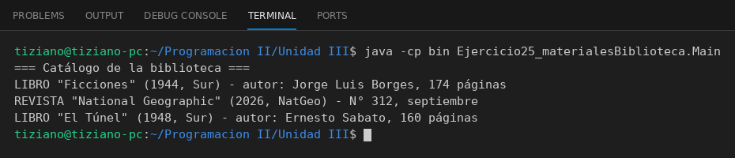

# MaterialBiblioteca

Programación II - Unidad 3 - Ejercicio 25

## Consigna
Modelar una jerarquía de clases con herencia: una clase base y subclases que reutilizan código con `super` y sobrescriben métodos. Materiales de una biblioteca.

## Lógica
- `MaterialBiblioteca` con título, año y editorial.
- `Libro` (autor, páginas) y `Revista` (número, mes) llaman a `super(...)`.
- `describir()` se reescribe en cada una.
- `Main` recorre una colección mixta.

## Ejecución

